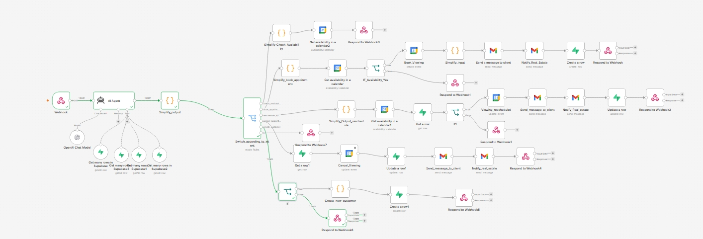
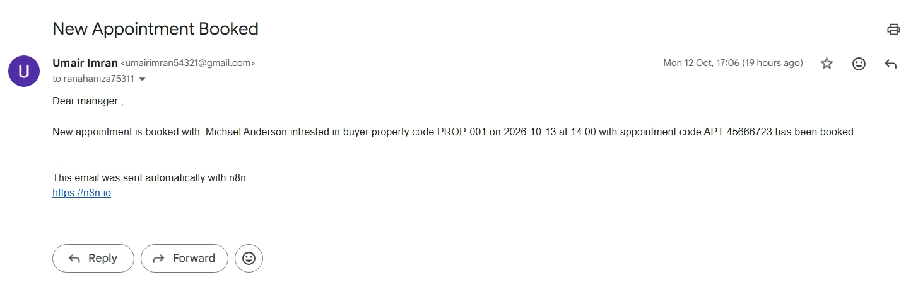

# EstateMind-AI-Intelligent-Real-Estate-Voice-Agent-Workflow-Automation-System
The Problem: Real Estate Inquiries Don't Follow Business Hours  Imagine a potential buyer discovers a property online at 2:00 AM. They want to know the price, location, available features, or whether they can arrange a viewing. They call the real estate agency, but nobody answers.
By the time an agent returns the call the next morning, the buyer may have contacted another agency, found another property, or lost interest.

Real estate businesses face this challenge every day. Property inquiries arrive outside office hours, agents spend valuable time answering repetitive questions, customer details get scattered across systems, and arranging property viewings often requires unnecessary back-and-forth communication.

Traditional chatbots may answer basic FAQs, but they often operate separately from the systems needed to search listings, manage leads, and schedule appointments. A conversation alone doesn't move a potential buyer through the property journey.

The Solution: An AI Real Estate Assistant That Does More Than Talk

EstateMind AI is an AI-powered real estate voice agent and workflow automation system built to handle property inquiries around the clock and connect conversations to real operational workflows.

Powered by ElevenLabs conversational AI and n8n automation, the system can interact with potential buyers, understand their requirements, retrieve relevant property information from connected data sources, capture customer details, and support appointment booking and management.

Instead of simply telling a caller to contact the office during business hours, EstateMind AI provides a way to engage with the business when human agents are unavailable.

What Makes EstateMind AI Different?

1. 24/7 Voice-Based Communication

Potential buyers can speak naturally with an AI voice assistant, including outside regular business hours. This creates an always-available first point of contact without requiring an employee to answer every call personally.

2. Property Information Based on Actual Records

The system can retrieve property details from its connected data source rather than relying solely on static FAQ responses. Depending on the available listing data, it can help answer questions about location, price, property type, bedrooms, bathrooms, area, and features.

3. Customer and Lead Management

The workflow captures relevant buyer information, including contact details, budget, preferred locations, requirements, and purchase timeline. It is designed to check for existing customers before creating new records, helping reduce duplicate leads.

4. Appointment Workflow Automation

The system supports property-viewing and consultation workflows, including appointment booking, availability checks, rescheduling, and cancellation. These actions depend on the connected tools, available records, and confirmed results.

5. Connected AI and Business Operations

Rather than treating the conversation as the end of the process, EstateMind AI connects the voice interface to automation workflows and business data. This makes it possible to turn an inquiry into a structured lead or an appointment workflow.

Core Features

24/7 AI-powered real estate voice assistance

Natural-language property inquiries

Property search and listing-detail retrieval

Buyer requirement and budget collection

Structured customer and lead creation

Duplicate customer detection and existing-record reuse

Appointment availability checks and booking workflows

Appointment rescheduling and cancellation workflows

Structured data exchange between the voice agent and automation workflows

Defined handling for missing information, unavailable records, and failed tool operations

Integration-ready architecture for real estate databases and business systems

Skills & Technologies Used

ElevenLabs: Conversational AI voice-agent experience and natural voice interactions.

n8n: Workflow orchestration, conditional routing, data processing, and business-process automation.

OpenAI / LLM Integration: Intent recognition, natural-language understanding, and structured extraction of customer requirements.

REST APIs & Webhooks: Communication between the voice agent and backend automation workflows.

Database Integration: Retrieval and management of property listings, customer records, and appointments through connected data sources.

JavaScript: Data normalization, validation, field mapping, and workflow logic.

Structured JSON: Consistent exchange of customer, property, intent, and appointment information between workflow components.

Workflow Error Handling: Explicit handling of missing details, failed lookups, ambiguous appointment references, and unsuccessful operations.

Business Value

EstateMind AI is designed to help real estate businesses:

Respond to potential buyers beyond normal office hours.

Reduce repetitive inquiry-handling work for agents.

Capture leads that might otherwise go unanswered.

Retrieve property information from connected business records.

Reduce duplicate customer entries through lookup-before-create logic.

Streamline property-viewing and consultation scheduling.

Create a more consistent experience from the first inquiry to the next action.

Example Scenario

A potential buyer calls at 2:00 AM and asks for a two-bedroom apartment in a preferred location within a specific budget.

The AI voice agent understands the buyer's requirements.

The workflow retrieves matching listings from the connected property data source.

The assistant communicates relevant details based on the records returned.

The workflow collects the buyer's contact information and checks for an existing customer record.

If the buyer requests a viewing, the system checks the relevant appointment workflow and proceeds according to confirmed availability.

The resulting customer and appointment information can be stored in the connected business system.

The buyer can begin the process without waiting for the office to open.

Project Goal

The goal of EstateMind AI is to demonstrate how conversational voice AI and workflow automation can work together to address a real operational problem in real estate: missed inquiries, repetitive communication, disconnected customer records, and time-consuming appointment coordination.

This project combines voice interaction with data retrieval and business-process automation to create a more useful assistant than a standalone FAQ chatbot.

Project Stack

ElevenLabs · n8n · OpenAI · JavaScript · REST APIs · Webhooks · JSON · Database Integration

Future Extensions

The architecture can be extended with CRM integrations, multilingual voice support, automated follow-up messages, lead qualification, property recommendations based on buyer preferences, and agent handoff for inquiries requiring human judgment.

EstateMind AI — Every inquiry matters. Every hour counts.
## Screenshots

## Workflow
,

## Appointment Booked Email
,

## Appointment Reschedule Email
,

## Appointment Cancel Email

